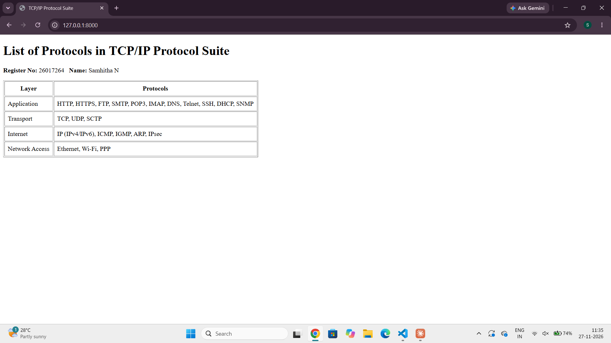

# EX01 Developing a Simple Webserver
## Date:22.11.2026

## AIM:
To develop a simple webserver to serve html pages and display the Windows Specifications of your Laptop.

## DESIGN STEPS:
### Step 1: 
HTML content creation.

### Step 2:
Design of webserver workflow.

### Step 3:
Implementation using Python code.

### Step 4:
Import the necessary modules.

### Step 5:
Define a custom request handler.

### Step 6:
Start an HTTP server on a specific port.

### Step 7:
Run the Python script to serve web pages.

### Step 8:
Serve the HTML pages.

### Step 9:
Start the server script and check for errors.

### Step 10:
Open a browser and navigate to http://127.0.0.1:8000 (or the assigned port).

## PROGRAM:
```
from http.server import HTTPServer, BaseHTTPRequestHandler

content = """
<!DOCTYPE html>
<html>
<head>
<title>TCP/IP Protocol Suite</title>
</head>
<body>
<h1>List of Protocols in TCP/IP Protocol Suite</h1>
<p><b>Register No:</b> 26017264 &nbsp; <b>Name:</b> Samhitha N</p>
<table border="1" cellpadding="8">
<tr><th>Layer</th><th>Protocols</th></tr>
<tr><td>Application</td><td>HTTP, HTTPS, FTP, SMTP, POP3, IMAP, DNS, Telnet, SSH, DHCP, SNMP</td></tr>
<tr><td>Transport</td><td>TCP, UDP, SCTP</td></tr>
<tr><td>Internet</td><td>IP (IPv4/IPv6), ICMP, IGMP, ARP, IPsec</td></tr>
<tr><td>Network Access</td><td>Ethernet, Wi-Fi, PPP</td></tr>
</table>
</body>
</html>
"""

class myhandler(BaseHTTPRequestHandler):
    def do_GET(self):
        print("request received")
        self.send_response(200)
        self.send_header('content-type', 'text/html; charset=utf-8')
        self.end_headers()
        self.wfile.write(content.encode())

server_address = ('', 8000)
httpd = HTTPServer(server_address, myhandler)
print("my webserver is running...")
httpd.serve_forever()

```

## OUTPUT:




## RESULT:
The program for implementing simple webserver is executed successfully.
